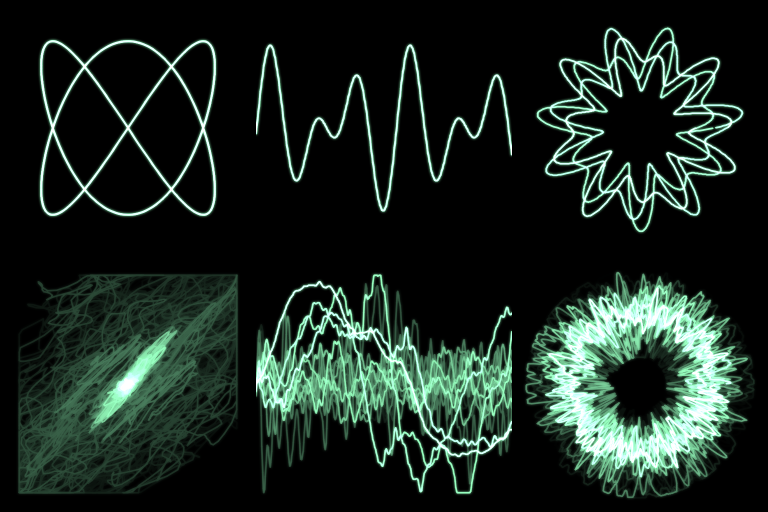
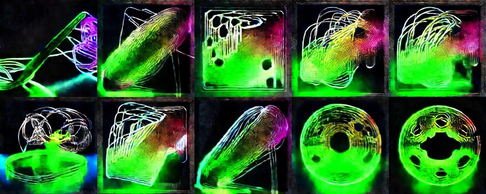
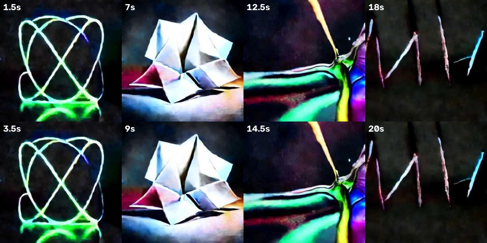
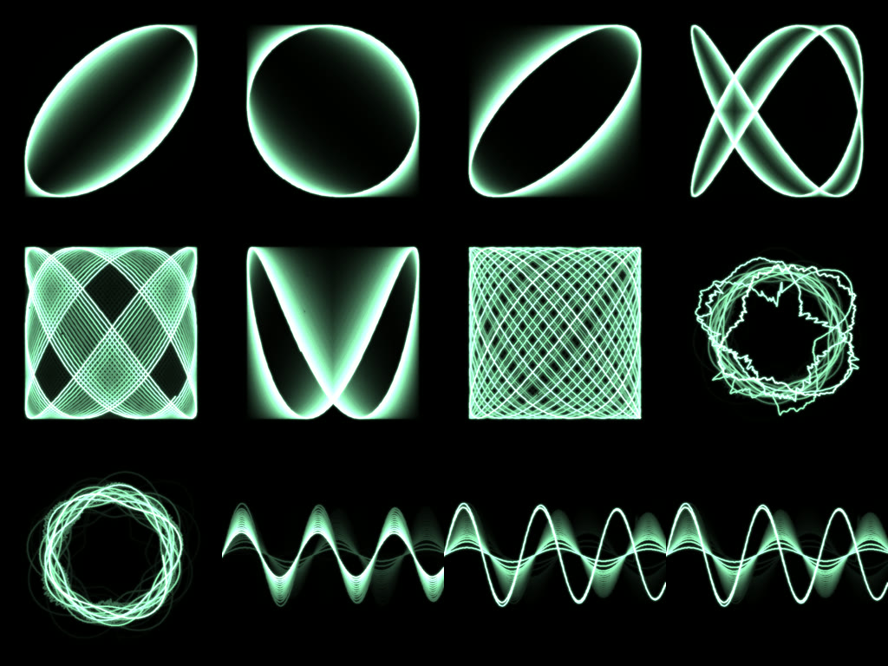
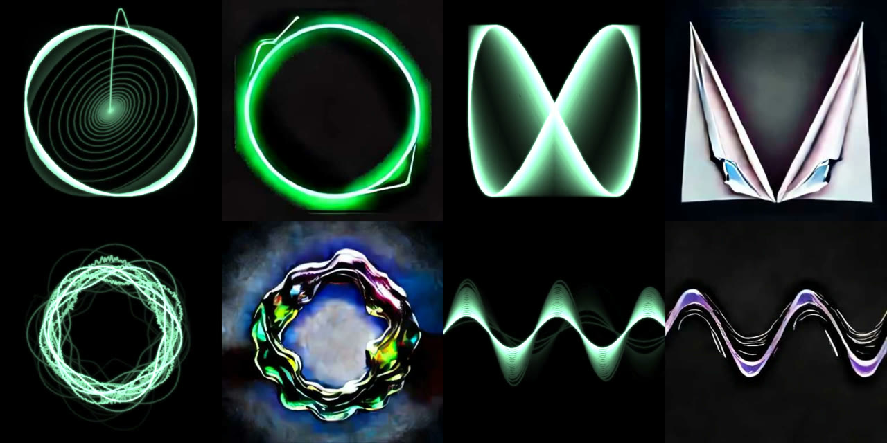

# td-oscilloscope-ai

音のサンプルそのものを線で描くオシロスコープ映像を TouchDesigner で組み、自作の StreamDiffusion で
別の素材にリアルタイムで読み替える作品のリポジトリ。音が形を描き、読み替えの激しさも音が決める。

出発点は uisato の2作:
[Oscilloscopes, Everywhere](https://uisato.studio/tools/oscilloscopes-everywhere)（TD の音×幾何学プリセット集）と
[Oscilloscope Diffusion](https://uisato.studio/oscilloscope-diffusion)（SDXL によるオフラインの video-to-video）。
どちらも中身は使っておらず、XY オシロスコープという公知の技法から自作している。違いは、変換をリアルタイムで回し、
その強さを音で動かすこと。

前作: [td-organic-patterns](https://github.com/ryok/td-organic-patterns)（油膜の映像 × 自作 StreamDiffusion）

## 進み具合

| # | 内容 | 状態 |
|---|---|---|
| S1 | オシロスコープ映像（XY・波形・極座標＋残光） | 済 |
| S2 | 自作 StreamDiffusion に送り、拡散の効き方を調整 | 済 |
| S3 | 曲のセクションごとにプロンプト・強さを切り替える | 済 |
| S4 | スコープ用の曲を作る | 済 |
| S5 | 本番録画と公開 | 録画済み・公開前 |

## 使い方

1. TouchDesigner で新規または既存のプロジェクトを開く（`/project1` を使う）
2. Textport で [scripts/build_oscilloscope.py](scripts/build_oscilloscope.py) を実行する
   （`exec(open('/path/to/scripts/build_oscilloscope.py').read())`。他の場所に置いたときは環境変数
   `TD_OSC_SCRIPTS` に scripts のパスを入れる）
3. `/project1/osc_out` を表示する。既定はテスト音（左440Hz・右660Hz）・XY モード
4. 切り替え:
   - `op('/project1/osc_src').par.index = 1` で実音へ（`/project1/aud_in` という Audio Device In CHOP があれば繋がる）
   - `op('/project1/osc_ctrl').par.value0 = 0|1|2` で XY / 波形 / 極座標



（左から XY・波形・極座標。上段はテスト音 440/660Hz で、XY は 2:3 のリサージュ図形。下段は実曲を
Audio File In CHOP で一時的に流した状態。）

## 設計のポイント（Script TOP + cv2 で折れ線を描く）

```
osc_tone_l (440Hz) ─┐
osc_tone_r (660Hz) ─┴ osc_tone ─┐
aud_in（あれば）─────────────────┴ osc_src ─ osc_lr ─ osc_draw ─┬─ osc_comp ─ osc_glow ─ osc_bloom ─ osc_out
                    (0=テスト音 / 1=実音)  (l, r)  (Script TOP)    │  ↑ max
                                                                 osc_fb ─ osc_decay（残光）
```

- **描き方は3つ**（`osc_ctrl` の `mode`）。XY は x=左・y=右で、ステレオの位相関係がそのまま図形になる。
  波形は x=時間・y=(左+右)/2。極座標は角度=時間・半径=0.55+0.4×振幅。
- **CHOP to SOP → Render ではなく、Script TOP の中で numpy と cv2.polylines で描く**。毎フレーム数百点の
  折れ線だけなので、カメラ・Line MAT を組むよりノードが少なく、線幅（`thick`）も1か所で変えられる。
- **1画面に描くのは 1/60 秒ぶんに固定**。音声系 CHOP はタイムスライスで「前回のクックからのぶん」を出す
  ので、普段は約735点だが、クックが飛ぶと 8820点（0.2秒ぶん）になる。量を固定しないと図形の密度がぶれる。
- **波形は一番急な上向きゼロ交差で揃える**（トリガ）。和音は1周期に上向きのゼロ交差が複数あり、
  最初の交差で揃えると、フレームごとに違う位相で始まって波形が2重3重に見えた。
- **残光は「前フレーム×decay」と今フレームを max で重ねる**（add だと重なりが白く飛ぶ）。そのあと
  ぼかしを add してにじみを足す。
- 操作値は `osc_ctrl`（Constant CHOP）: `mode` / `gain`（振幅→画面の倍率）/ `thick`（線幅px）/ `decay`（残光の残り率）

## 実装上の要点（ハマりどころ）

- **残光ループは 16bit float にする**（`osc_fb` / `osc_decay` / `osc_comp`）。8bit のままだと暗い画素が
  4×0.88=3.52→4 と丸め戻されて消えず、前のモードの線がうっすら残り続けた。
- **表示していないと残光が進まない**。TD は参照されているノードしか計算しない。`osc_out` をどこにも
  表示せずに `get_top_image` などで1枚だけ取ると、数回分しかフィードバックが回っておらず、
  前の図形が重なって見える。確認のときは一時的な Execute DAT で毎フレーム `osc_out` を cook する。
- **Audio File In CHOP の `volume=0` は出力サンプルも0にする**（スピーカーに鳴らさない設定ではない）。
  Audio File In はもともとデバイスに音を出さないので、`volume=1` のままでよい。
- **実曲は XY でほぼ右上がりの斜線になる**。ふつうのミックスは左右がほぼ同じ（モノラル寄り）なので、
  x≒y に集まる。マスタリング済みの曲は `gain=0.85` だと枠の端で切れる。図形として見せるには、
  曲側でステレオの位相を設計するか、`gain` を下げる。

## AI 変換（AI Bridge）

`osc_out` を自作の StreamDiffusion サーバー（[streamdiffusion-ws](https://github.com/ryok/streamdiffusion-ws)）へ
WebSocket で送り、変換結果を `/project1/ai_out` に受ける。音が大きいほど変換を強くする（t_index を下げる）。

1. GPU 側でサーバーを起動する（GPU 番号は `nvidia-smi` で空きを見て選ぶ）
   ```
   CUDA_VISIBLE_DEVICES=2 python -u sd_ws_server.py --size 384 --acceleration xformers \
     --t-index 22 32 --guidance-scale 5 --cfg-type full --out-quality 50 --port 8765 \
     --prompt "intricate glowing neon wire sculpture, liquid chrome filaments, dark background, cinematic light, highly detailed"
   ```
2. Mac から SSH トンネルで 8765 を繋ぐ（`ssh -N -L 8765:localhost:8765 <gpu-host>`）
3. TD で [scripts/build_oscilloscope.py](scripts/build_oscilloscope.py) → [scripts/build_ai_bridge.py](scripts/build_ai_bridge.py) の順に実行
4. 別の操作で `op('/project1/websocket1').par.active = 1`（同じスクリプト内で 0→1 にしても繋がらない）
5. `/project1/ai_out` を見る



（実曲を流して録画した 26 秒から2秒おきに切り出したフレーム。上段から下段の途中までが XY、下段右2枚が極座標。
音の大きさに合わせて t_index が [14,24]〜[6,16] の間で動いている。）

### 設計のポイント

- **td-organic-patterns の AI Bridge の移植**。送信元を `osc_out` に、音の大きさを `ai_energy`（`osc_lr` の
  RMS を左右で平均し、Lag で上がり 0.05 秒・下がり 0.4 秒にならしたもの）に替えた。オシロが描いている音
  そのものの大きさで変換の強さが動く。
- **t_index の範囲は油膜の時より強い側にずらした**。テスト音の XY で比べた結果:

  | t_index | 黒地の細い線がどうなるか |
  |---|---|
  | [22,32]・[12,22]（organic-patterns の範囲） | ほぼそのまま返る |
  | [10,20] | 線の形を保ったままネオン管の質感になり、床に反射が出る |
  | [6,16] | 形が崩れて別の物（ネオンの花）になる |

  油膜は画面全体に模様があるが、オシロは大半が黒で、拡散モデルが手がかりにできる情報が少ない。
  そのため同じ強さでは何も起きない。無音で [14,24]（形が読める）、大音量で [6,16]（形が溶ける）に写す。
- **音の大きさは下限から写す**（`E_FLOOR=0.12`〜`E_FULL=0.4`）。実曲 12 秒の RMS は p5=0.13・中央値=0.27・
  p95=0.39 だった。0 起点で写すと、静かな所でも半分以上の強さになって形が残らない。

### 実装上の要点（ハマりどころ）

- **Math CHOP で左右を平均するのは `chanop`（Combine Channels）**。`chopop` は複数の入力 CHOP どうしの演算で、
  入力が1つだと何もしない（`l` と `r` の2チャンネルのまま出てきた）。
- **マスタリング済みの曲は XY で四角い枠が出る**。リミッターで ±1 に張り付いたサンプルが枠の辺に並び、
  AI もそれを「額縁」として描く（上の画像の上段）。曲側（S4）で解決する予定（`gain` を下げたときの見え方はまだ試していない）。
- **フレームレートは GPU の混み具合で変わる**。共有の GPU で他のジョブが使用率 100% のとき、4〜10fps
  （中央値 4.9fps）だった。

## セクション切り替え（Sections）

曲のセクションごとに、AI に描かせるもの（プロンプト）・変換の強さの範囲・オシロの描き方を切り替える。

1. [scripts/build_oscilloscope.py](scripts/build_oscilloscope.py) → [scripts/build_ai_bridge.py](scripts/build_ai_bridge.py) →
   [scripts/build_sections.py](scripts/build_sections.py) の順に実行
2. セクションは `/project1/sec_table` に1行ずつ書く

   | 列 | 中身 |
   |---|---|
   | `bars` | 長さ（小節） |
   | `name` | 名前（表示用） |
   | `mode` | 0=XY / 1=波形 / 2=極座標 |
   | `gain` | 振幅→画面の倍率（`osc_ctrl` の `gain`）。空欄なら変えない |
   | `quiet` | 無音のときの t_index（例 `14,24`）。大きいほど元の形に忠実 |
   | `loud` | 大音量のときの t_index（例 `6,16`）。小さいほど読み替えが強い |
   | `prompt` | そのセクションで AI に描かせるもの |

3. 曲の頭で `op('/project1/sec_driver').module.cue()`。以後は小節を数えて自動で進む（最後の次は先頭へ）
   - 手動: `module.go(2)`（自動を止めてセクション2へ）、`module.auto(True)`（自動に戻して cue し直す）



（テスト音で、仮の4セクションを各2小節に縮めて1周させた録画から切り出したもの。左から intro=XY×ネオン、
build=極座標×折り紙、peak=XY×液体金属、break=波形×墨。テスト音は大きさが一定なので、どれも大音量側の強さ。）

### 設計のポイント

- **時計は Ableton Link か内部時計**。Link に相手がいれば（`numpeers`≥1）Link の小節位置、いなければ
  一定の BPM（88）で数える。Link で共有されるのは拍の格子だけで、小節番号は曲の頭と揃わないので、
  曲の頭で `cue()` して「cue から何小節目か」で決める。`ablink` が既にあればそれを使い、無ければ `sec_link` を作る。
- **プロンプトは予約して、AI 送信の空き枠で送る**。画像・強さ（TINDEX）・プロンプトは同じ「返信待ち」の枠を
  使うので、セクション側から直接送ると返信待ち中に取りこぼす。`request_prompt()` で予約し、`ai_driver` が
  次の送信スロットで最優先に送る。
- **強さの範囲は `sec_state` に置き、`ai_driver` が毎回読む**。`sec_state` が無ければ AI Bridge の既定
  （無音 [14,24]・大音量 [6,16]）のまま動く。
- **Ableton のシーンに合わせて即興で切り替えるとき**は `go()` を MIDI / OSC の受け口から呼ぶ（未配線。S4 は Arrangement を頭から流す運用にした）。

### 確かめたこと

- 88BPM・各2小節で、切り替えが 5.45 秒おき（2小節 = 2×4×60/88 秒）に起き、1周して先頭に戻った。
- プロンプト差し替えは送信から返信まで 33〜50ms（60fps で2〜3フレーム）。切り替えの瞬間に映像が止まって見える長さではない。
- サーバー側のログで、セクションの順にプロンプトが届いていることを確認した。

## スコープ用の曲（Song）

曲そのものを、オシロに映る図形から設計した。Ableton のセットは
[ableton/scope_song Project/scope_song.als](ableton/scope_song%20Project/scope_song.als)（88BPM・各8小節×4・約87秒、
Arrangement に並べてある。音源は Live 標準の Operator と 909 Core Kit だけ）。

| セクション | 音 | 描き方 | 図形 |
|---|---|---|---|
| intro | 左右とも D3 の純音。右は位相90°・0.2% 高い | XY | 円 ↔ 斜線を約3.4秒周期で行き来する |
| build | 左 D3、右が2小節ごとに A3→G3→D4→F#3 | XY | 3:2 → 4:3 → 2:1 → 5:4 のリサージュ図形 |
| peak | 3:2 を8分で刻む＋キック・クラップ・ハット・ベース（中央） | 極座標 | ドラムで輪がとげとげに崩れる |
| break | 左右同じ Dm→C→B♭→A のアルペジオ | 波形 | 和音の重なった波 |

1. Ableton の出力を BlackHole を含む複数出力装置（例「TD+Speakers」）にし、Output Config で 1/2 を有効にする
2. TD で `/project1/osc_src` を 1（`aud_in` = BlackHole）にする
3. Ableton で頭から再生し、同時に `op('/project1/sec_driver').module.auto(True)`



（曲を頭から通して再生し、`osc_out` を保存したもの。上段 intro 3枚＋build 3:2、中段 build 4:3・2:1・5:4＋peak、
下段 peak＋break。）

### 設計のポイント

- **左右を振り切った純音（Operator のサイン波）で描く**。XY は左右の位相関係がそのまま図形になるので、
  音色の倍音や左右に広がるリバーブは線を濁らせる。図形用の音はサイン波1本ずつにし、ドラム・ベースは
  中央に置いて peak だけに入れた。
- **同じ高さで0.2%ずらすと、図形がゆっくり回る**。位相90°の同じ高さなら円、そこから約0.3Hz のずれで
  位相差が回り、円 → 斜めの楕円 → 斜線 → 円を約3.4秒で繰り返す（耳では「うなり」に聞こえる）。
- **極座標は純音の区間で使わない**。1画面 = 1/60 秒に D3（147Hz）は2.4周しか入らず、輪が閉じない。
  peak のドラムのように、波形が荒いときに輪の揺らぎとして効く。
- **セクションごとに `gain` を替える**。純音は振れ幅 0.3 ほどで、`gain=0.85` では画面の4分の1にしかならない。
  intro・build は 2.6、break は 2.2、ドラムの入る peak は 1.0（振れ幅 0.77 まで出るため）。

### 実装上の要点（ハマりどころ）

- **メトロノームは BlackHole にも入る**。Live のクリックは Cue 出力（既定で Master と同じ 1/2）に出るので、
  XY に1拍ごとの跳ね（1.1〜1.6kHz）が毛羽のように残った。録るときはメトロノームを切る。
- **音量のバランスがそのまま変換の強さになる**。最初はドラム -8dB・ベース -6dB で、peak の音量（ai_energy の
  中央値 0.15）が intro（0.21）より小さく、盛り上がる所で変換が一番弱くなった。両方 0dB にして peak を
  中央値 0.27・上位10% 0.36 に上げた。
- **Ableton の出力を替えたら Output Config を確認する**。新しい出力デバイスでは 1/2 が無効のことがあり、
  メーターは振れても BlackHole に音が出ない。

### 確かめたこと

- 頭から通しで再生し、セクション（0→1→2→3）と描き方（XY→XY→極座標→波形）が予定の時刻に切り替わった。
- メトロノームを切ったあと、intro・build で1/60秒内の隣り合うサンプルの差が 0.05 を超えたのは各約1300フレーム中5回
  （音の打ち直しの瞬間）。
- Ableton シーン → `go()` の MIDI/OSC 配線はしていない。Arrangement を頭から流して `auto(True)` で揃える運用にした
  （内部時計 88BPM。境界ちょうどのずれは測っていない）。

## 本番録画（Recorder）

[scripts/build_recorder.py](scripts/build_recorder.py) で、オシロ（左）と AI の変換結果（右）を 1280×640 に並べ、
`aud_in` の音と一緒に `rec_pair_out`（Movie File Out）で録る。

1. GPU サーバーを起動し、トンネルを張る（「AI 変換」の節）。録画の直前に `websocket1` を active 0 → 1 で繋ぎ直す
2. `rec_pair_out` の `record` を True → Ableton を頭から再生 → `sec_driver.module.auto(True)`
3. 曲の終わり（約88秒）で Ableton を止め、`record` を False
4. ffmpeg で音の頭に合わせて切り、H.264＋AAC にする。AI だけの版は右半分を切り出す（`crop=640:640:640:0`）



（2026-10-17 の録画（3回目）から。左右ペアで上から intro・build・peak・break。）

### 実装上の要点（ハマりどころ）

- **Layout TOP は出力解像度を明示する**。既定のままだと 640×640 の中に2枚を縮めて並べ、上下に黒帯が出た。
- **トンネルの後片付けで `lsof -ti tcp:8765 | xargs kill` をしない**。8765 に繋いでいる TouchDesigner
  （WebSocket DAT）まで落ちる。止めるのは tunnel.sh の PID と、待ち受け側（`lsof -ti tcp:8765 -sTCP:LISTEN`）だけ。
- **AI が遅いときは、同じ GPU に他人のジョブが載っていないかを見る**。1回目の録画は AI の更新が約2.4fps
  （サーバー側 中央値 293ms/枚）だった。測り分けると:

  | 測ったもの | 結果 |
  |---|---|
  | GPU 単体の推論（[scripts/bench_sd.py](scripts/bench_sd.py)、cfg full・384px） | 中央値 58ms、ただし p90 259ms（ときどき跳ねる） |
  | JPEG の復号・符号化 | 各1ms 前後 |
  | Mac → トンネル → サーバー → Mac の往復（他のジョブが抜けた後） | 中央値 75ms（13fps） |

  `nvidia-smi --query-compute-apps` で、録画中は GPU1 に他のユーザーのプロセスが4つ載っていた。
  `nvidia-smi` の使用率は瞬間値なので「0%」でも当てにならない。抜けた後に録り直すと、サーバー側は
  中央値 55ms、TD 側の AI 更新は約8fps（88秒で約730回）になった。
- TD 側が 13fps まで届かないのは、返信待ちの枠が1つで、4回に1回は強さ（TINDEX）の送信に使うためと見ている（未計測）。

## 動作環境

TouchDesigner 2023.12230（macOS）で確認。
